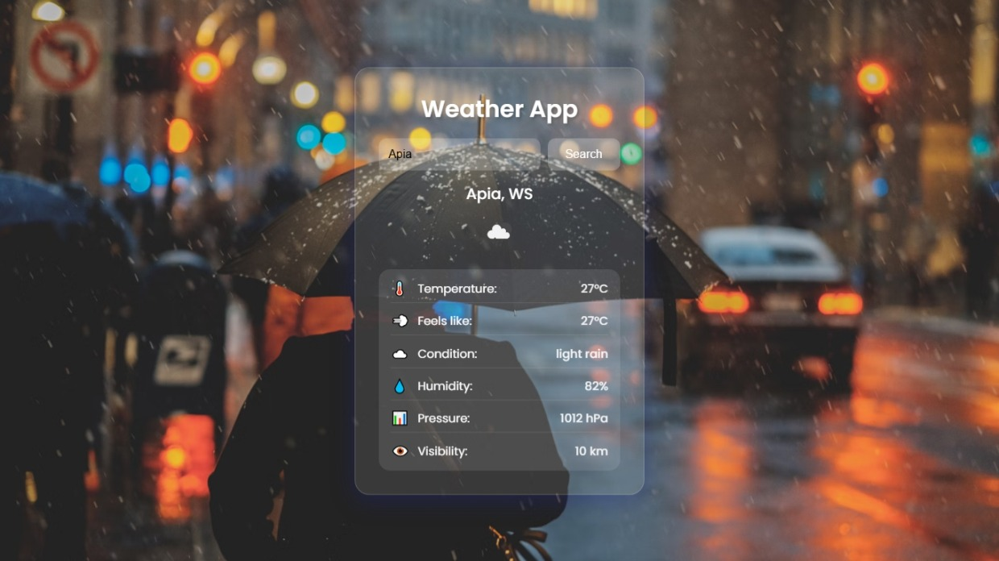

# Advance Weather App (HTML, CSS & JavaScript)

This is a visually appealing and responsive weather application built using HTML, CSS, and JavaScript. It fetches real-time weather data from the OpenWeatherMap API and presents it with smooth animations, icons, and a dynamic background that changes based on the current weather condition.

## Features

* 🌤️ Real-time weather information using **OpenWeatherMap API**
* 🎨 Modern **glassmorphism UI** with dynamic backgrounds
* 🔍 Search for any city to get current weather details
* 🖼️ Animated display of weather details and transitions
* 🌐 Fully responsive and mobile-friendly design
* 🎯 Includes temperature, humidity, pressure, visibility, condition, and more

## Project Structure

* **index.html** — The main HTML file containing the structure of the app.
* **style.css** — External CSS file for visual design, animations, layout, and responsiveness.
* **config.example.js** — Template for `config.js`, which holds your API key (not committed).
* **script.js** — External JavaScript file containing logic to fetch data from the API, update the UI, handle search, and apply animations.
* **OpenWeatherMap API** — External service used to retrieve live weather data.
* **Unsplash Backgrounds** — Background images change dynamically based on weather conditions using high-quality Unsplash images.

## How to Use

1. Clone the repository or download the project files.
2. Open the `index.html` file in any modern browser.
3. Enter a city name and click **Search** or press **Enter**.
4. View the current weather data with animated visuals.

> ⚠️ You’ll need a free **OpenWeatherMap API key** to run this project.

Copy `config.example.js` to `config.js` and put your key in it:

```javascript
window.WEATHER_API_KEY = 'YOUR_API_KEY_HERE';
```

`config.js` is listed in `.gitignore`, so your key stays out of the repository. Keep in mind that any key used by front-end code can still be seen in the browser; for a public deployment, route requests through a small serverless proxy that holds the key.

## Demo Preview



## Technologies Used

* HTML5
* CSS3 (Glassmorphism, Animations)
* JavaScript (Fetch API, DOM manipulation)
* OpenWeatherMap API
* Unsplash (for background images)

## License

This project is open-source and free to use under the [MIT License](LICENSE).

