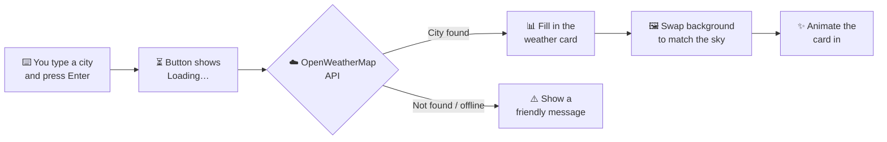

<div align="center">



<br>


**Type a city. Get the weather. Watch the sky change behind it.**

A glassmorphism weather app in plain HTML, CSS and JavaScript, with no frameworks and no build step.

[✨ Features](#-features) · [🖼️ Backgrounds](#%EF%B8%8F-a-background-for-every-sky) · [🚀 Getting Started](#-getting-started) · [⚙️ How It Works](#%EF%B8%8F-how-it-works) · [🛠️ Troubleshooting](#%EF%B8%8F-troubleshooting)

<br>


<sub><i>Searching "Apia" on a rainy day: the card animates in and the background switches to rain.</i></sub>

</div>

<br>

## ✨ Features

<table>
<tr>
<td width="50%" valign="top">

### 🌤️ Live weather
Current conditions for any city from the OpenWeatherMap API, including names with spaces or accents like *São Paulo*.

### 🖼️ Dynamic backgrounds
The page background changes to match the sky: sunny, cloudy, rainy, stormy, snowy or misty.

### ✨ Smooth animations
The card fades in and each detail row slides up one after another.

</td>
<td width="50%" valign="top">

### 📊 Six weather details
🌡️ Temperature · 💨 Feels like · ☁️ Condition · 💧 Humidity · 📊 Pressure · 👁️ Visibility

### ⚠️ Friendly errors
Clear messages for unknown cities, connection problems or a missing API key, plus a loading state while it searches.

### 📱 Works everywhere
Responsive on phones and desktops, readable by screen readers, and calmer for people who turn on reduced motion.

</td>
</tr>
</table>

## 🖼️ A background for every sky

<table>
<tr>
<td align="center"><br><b>☀️ Clear</b></td>
<td align="center"><br><b>☁️ Clouds</b></td>
<td align="center"><br><b>🌧️ Rain</b></td>
<td align="center"><br><b>🌦️ Drizzle</b></td>
</tr>
<tr>
<td align="center"><br><b>⛈️ Thunderstorm</b></td>
<td align="center"><br><b>❄️ Snow</b></td>
<td align="center"><br><b>🌫️ Mist · Fog · Haze</b></td>
<td align="center"><br><b>🏠 Before you search</b></td>
</tr>
</table>

<sub>Photos from <a href="https://unsplash.com">Unsplash</a>.</sub>

## 🚀 Getting Started

> [!IMPORTANT]
> You need a free **OpenWeatherMap API key**. The app shows *"Missing API key"* until you add one.

**1. Get a key.** Sign up at [openweathermap.org](https://home.openweathermap.org/users/sign_up) and copy your key from the **API keys** page. New keys can take up to a couple of hours to activate.

**2. Download the project.**

```bash
git clone https://github.com/maoozgul20/Weather-App.git
```

Or click **Code → Download ZIP** above and unzip it.

**3. Add your key.** Make a copy of `config.example.js` named `config.js` and paste your key in:

```javascript
window.WEATHER_API_KEY = 'YOUR_API_KEY_HERE';
```

**4. Open `index.html`** in any browser, type a city and press **Enter**. 🎉

> [!TIP]
> Searching for a common name like *London*? Add the country code (`London,GB` or `London,CA`) to get the one you mean.

## ⚙️ How It Works



<details>
<summary><b>📁 Project structure</b> (click to expand)</summary>

<br>

| File | What it does |
| --- | --- |
| `index.html` | Page layout: search form and weather card |
| `style.css` | Glassmorphism look, animations and mobile layout |
| `script.js` | Fetches the weather, fills in the card, picks the background, handles errors |
| `config.example.js` | Template for your `config.js` |
| `config.js` | Your own API key. You create this file, and it's never uploaded to GitHub |
| `assets/banner.svg` | The animated banner at the top of this page |

</details>

<details>
<summary><b>🔐 Keeping your API key safe</b> (click to expand)</summary>

<br>

`config.js` is listed in `.gitignore`, so your key stays off GitHub. Any key used by front-end JavaScript can still be seen in the browser's developer tools, though. If you publish the app online, consider sending requests through a small serverless function (Netlify, Vercel or Cloudflare) that keeps the key on the server.

</details>

## 🛠️ Troubleshooting

<details>
<summary><b>Seeing an error message?</b> (click to expand)</summary>

<br>

| Message | Fix |
| --- | --- |
| ⚠️ *Missing API key* | Create `config.js` from `config.example.js` (step 3). |
| 🔑 *Error: Invalid API key* | Check the key for typos, or wait for a new key to activate. |
| 🔍 *City not found* | Check the spelling, or add a country code like `Paris,FR`. |
| 📡 *Couldn't load weather* | Check your internet connection and try again. |

</details>

## 🗺️ Roadmap

- [x] Live weather search
- [x] Dynamic backgrounds and animations
- [x] Loading state and error messages
- [x] Mobile layout and accessibility
- [ ] 📍 Use my location
- [ ] 🌡️ °C / °F toggle
- [ ] 📅 5-day forecast
- [ ] 💾 Remember the last city
- [ ] 🌬️ Wind, sunrise and sunset
- [ ] 🌙 Day and night backgrounds

## 📄 License

Open source under the [MIT License](LICENSE). Weather data by [OpenWeatherMap](https://openweathermap.org), photos by [Unsplash](https://unsplash.com).

<div align="center">
<br>
<b>⭐ If you like this project, give it a star!</b>
</div>
